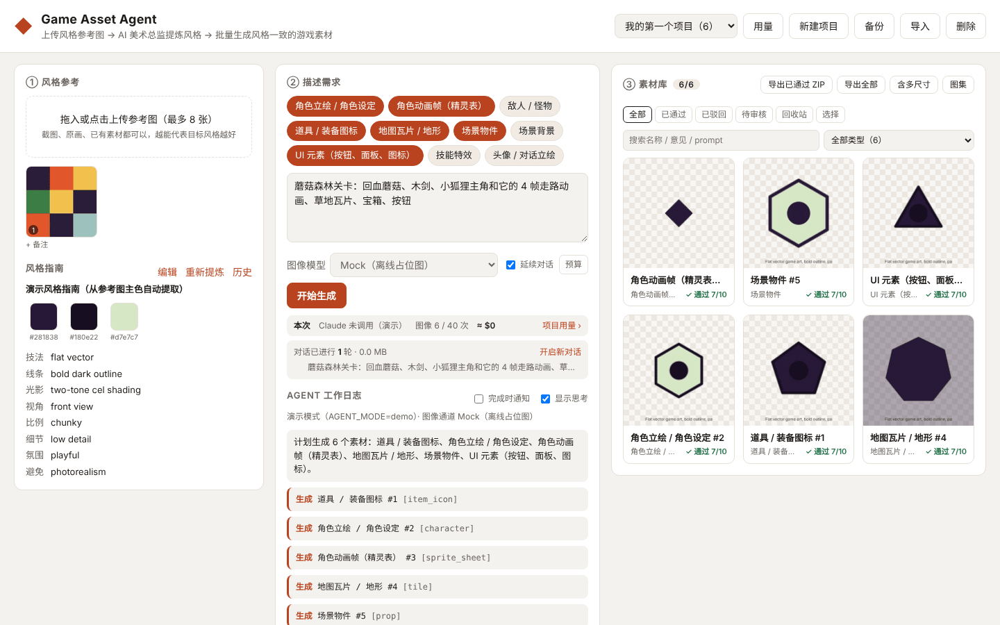
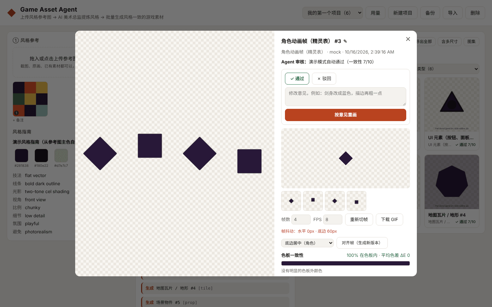

# Game Asset Agent

English · [中文](README.md)

[](https://github.com/wangchaozhi/game-asset-style-agent/actions/workflows/ci.yml)

Upload a few style reference images and let Claude act as your **AI art director**. It distils a reusable **style guide** from the references (palette hex codes, technique, line work, lighting, camera, proportions), plans an asset list from your request, generates the images with an image model, **looks at every result and reviews it**, and redraws whatever drifts — so you end up with a set of assets that look like they come from the same game.

<picture>
  <source media="(prefers-color-scheme: dark)" srcset="docs/screenshots/main-dark.png" />
  
</picture>

<sub>Screenshots are from demo mode (`AGENT_MODE=demo`) with offline placeholder art; with Claude and an image model connected you get real generations. The UI is in Chinese.</sub>

## Features

- 🎨 **Style extraction** — Claude analyses the references and saves a structured style guide that every later generation in the project reuses
- 🧩 **10 asset types** — characters, sprite sheets, enemies, item icons, tiles, props, backgrounds, UI, VFX, portraits
- 🔁 **Self-review loop** — each image is scored 1–10 for consistency against the references, with automatic palette, tile-seam and frame-jitter checks attached. Seams, jitter and leftover backgrounds are fixed with free post-processing tools; anything else is redrawn with specific feedback (at most twice per asset)
- 🎯 **Palette check** — ΔE distance in Lab space between an asset and the style palette: share of on-palette pixels and the main off-palette colours
- 🧬 **Cross-asset consistency** — approved assets (e.g. the hero's design sheet) can be passed as extra references for the same character's animation frames or portrait
- 🛠️ **Asset workbench** — sprite slicing and frame alignment, one-click seamless tiles, UI 9-slice margins with stretch preview, background removal, game-size exports, version compare (slider / side by side), editing a prompt and regenerating directly (no agent)
- 🗂️ **Library management** — search and type filters, batch approve / reject / redraw with feedback / export, trash (restorable for 7 days), style-guide history with rollback, notes on reference images, project backup and restore
- 📦 **Engine-ready exports** — ZIP per asset type (with common sizes, a manifest and Godot 4 `.tres` — `SpriteFrames` for sprite sheets, 9-slice `StyleBoxTexture` for UI), plus texture atlases (PNG + TexturePacker JSON, loads directly in Phaser / PixiJS) with Phaser animation definitions
- 💰 **Cost control** — live token / image usage and cost estimates, per-run caps on image calls and USD, automatic backoff on image-API rate limits
- 🔌 **Pluggable image models** — OpenAI `gpt-image-1` (multi-reference edits), Google Gemini Image, local Stable Diffusion WebUI (AUTOMATIC1111 / Forge, optional IP-Adapter for reference style), offline mock



## Quick start

```bash
npm install
cp .env.example .env   # set ANTHROPIC_API_KEY and one of OPENAI_API_KEY / GEMINI_API_KEY / SD_WEBUI_URL
npm start              # http://localhost:5173
```

Try the UI without any keys:

```bash
AGENT_MODE=demo npm start
```

Demo mode doesn't call Claude; a script runs the pipeline (style guide → generation → library) with local placeholder images.

## Deployment

### Docker

```bash
cp .env.example .env          # fill in your keys
docker compose up -d --build  # http://localhost:5173
```

Data lives in the `asset-data` volume (`/data` in the container). Change the port with `PORT=8080 docker compose up -d`. Without compose:

```bash
docker build -t game-asset-agent .
docker run -d -p 5173:5173 --env-file .env -v gaa-data:/data game-asset-agent
```

The image is a multi-stage build: TypeScript is compiled to `dist/`, the runtime layer has production dependencies only, runs as the non-root `node` user, and has a `/healthz` health check.

### Plain Node (≥ 22)

```bash
npm ci && npm run build
NODE_ENV=production npm run start:prod
```

### Before going public

- **Set `ACCESS_TOKEN`.** The UI then asks for the token once (an HttpOnly session cookie, 30 days); scripts send `Authorization: Bearer <token>`. `/healthz` stays open. Without it, anyone who can reach the port can spend your API credit.
- Jobs are tracked in memory: run **one instance** per data directory. A restart interrupts running jobs (assets already generated are kept; the run is marked interrupted).
- Server-sent events need proxy buffering off (Nginx: `proxy_buffering off;`).
- Failed logins are rate-limited per IP (10 per 10 minutes by default). Behind a reverse proxy set `TRUST_PROXY=1` (or `loopback`) so the real client IP is used.
- Responses carry a CSP, `nosniff`, no-framing and related security headers.

## Configuration

See [.env.example](.env.example). Data is stored under `data/` (git-ignored).

## HTTP API

Everything the UI does is available over HTTP (batch generation, exports, review…): see [docs/api.md](docs/api.md) (in Chinese), including a script that goes from creating a project to downloading an atlas.

## Development

```bash
npm run typecheck   # tsc (strict + unused checks, includes test/)
npm run lint        # ESLint for the browser modules in public/js
npm test            # node:test + tsx: storage, tool validation, image providers, image processing,
                    # atlases, ZIP, pricing, auth, the agent loop against a fake Messages API, HTTP API
npm run coverage    # tests + coverage (≥ 90% lines, 80% branches, 85% functions — enforced in CI)
npm run check       # all of the above
```

Tests use a temporary `DATA_DIR`; API tests start the app in demo mode on a random port, and the agent loop is exercised against a local fake of the Messages API that streams real SSE events — no API keys needed.

## How it works

The agent is a hand-written tool-use loop on the Anthropic TypeScript SDK (`src/agent/loop.ts`), using `claude-opus-5-5` with adaptive thinking, prompt caching and server-side refusal fallback. Its tools:

| Tool | Purpose |
|---|---|
| `save_style_guide` | Save the style guide distilled from the references (incl. an English `prompt_prefix`) |
| `generate_image` | Call the image model with the references (and optional approved assets) attached; the result image and automatic checks go back to Claude |
| `review_asset` | Record approve / reject, a consistency score and the reason |
| `fix_tile_seams` | Cross-fade a tile's edges into a seamless new version (no image-model call) |
| `align_sprite_frames` | Align a sprite sheet's frames on a shared anchor (no image-model call) |
| `remove_background` | Re-cut the background with another tolerance (no image-model call) |
| `snap_to_palette` | Recolour a flat / pixel-art asset to the style palette when stray colours appear (no image-model call) |

See the architecture section of the [Chinese README](README.md#架构) for the source layout.

## License

MIT
